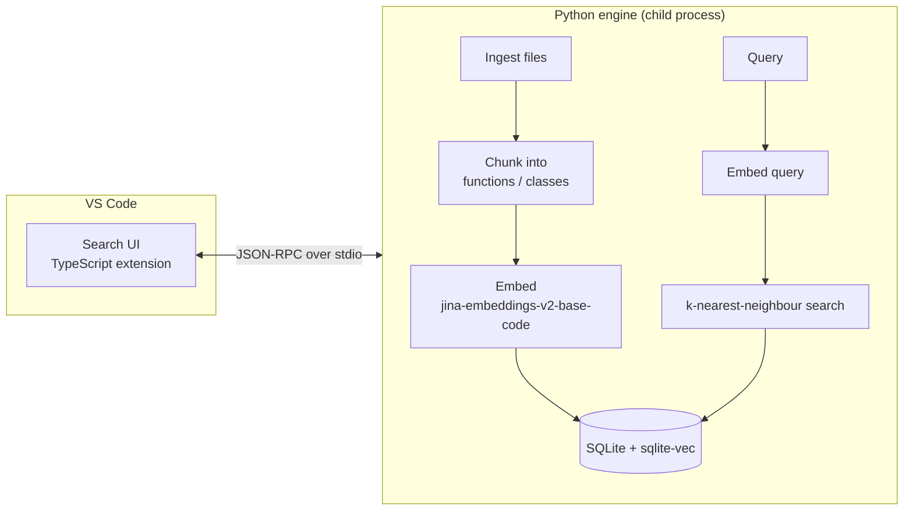

# CodeSense

[](https://github.com/Rithik1611/codeSense/actions/workflows/ci.yml)
[](LICENSE)

**Local-first semantic code search for VS Code.** Ask for code by what it *does*, for example "where do we retry failed HTTP requests?", and jump straight to the matching functions. Your source code never leaves your machine.

> **Status: Level 1 in progress. Not usable yet.**
> This is a learning project built in public. Its purpose is to deeply understand embeddings, vector databases, similarity search, chunking and retrieval by building a real developer tool. Progress is tracked in [docs/agenda/level-1.md](docs/agenda/level-1.md).

---

## Why

Text search finds exact words. It misses code that does the right thing under a different name. `fetchWithBackoff`, `retryRequest` and a `for` loop around `axios.get` can all "retry failed requests". CodeSense embeds code and queries into the same vector space and searches by meaning.

## How it works (Level 1 target)



See [docs/architecture.md](docs/architecture.md) for the full design and [docs/decisions/](docs/decisions/) for the reasoning behind each choice.

## Roadmap

| Level | Scope | Status |
|---|---|---|
| 1 | Single-repo semantic search: ingest → chunk → embed → vector store → search → VS Code UI | 🚧 In progress |
| 2 | Multiple repositories, incremental indexing, search filters | Planned |
| 3 | AST-aware chunking, keyword + hybrid search (RRF), reranking | Planned |
| 4 | Code relationships, related-test discovery, change impact | Planned |
| 5 | Benchmarks, retrieval metrics (Recall@K, MRR, nDCG), ablations | Planned |

## Tech stack

| Layer | Choice |
|---|---|
| Engine | Python 3.12, managed with [uv](https://docs.astral.sh/uv/) |
| Embeddings | [`jinaai/jina-embeddings-v2-base-code`](https://huggingface.co/jinaai/jina-embeddings-v2-base-code) via sentence-transformers + PyTorch (CPU) |
| Vector store | SQLite + [sqlite-vec](https://github.com/asg017/sqlite-vec) |
| Parsing | [tree-sitter](https://tree-sitter.github.io/) (TypeScript / JavaScript) |
| Extension | TypeScript, VS Code Extension API *(planned)* |
| Quality | ruff, mypy (strict), pytest, GitHub Actions |

## Repository layout

```
engine/      Python search engine (src/codesense, tests)
extension/   VS Code extension (planned, Step 11)
docs/        architecture, decisions (ADRs), agenda
.github/     CI workflows
```

## Development setup

**Prerequisites:** Git, [uv](https://docs.astral.sh/uv/getting-started/installation/), Node.js 20+ (for the extension, later).

```bash
git clone https://github.com/Rithik1611/codeSense.git
cd codeSense/engine
uv sync                     # creates engine/.venv with Python 3.12 and all dependencies
uv run pytest               # run tests
uv run ruff check .         # lint
uv run ruff format --check .
uv run mypy                 # strict type check
```

In VS Code, run **Python: Select Interpreter** and choose `engine/.venv`.

The first real indexing run downloads the embedding model (~300 MB) from Hugging Face. After that, everything runs offline.

## Privacy

CodeSense is local-first. Source code, embeddings and the index stay on your machine. The only network access is the one-time model download.

## License

[MIT](LICENSE)
