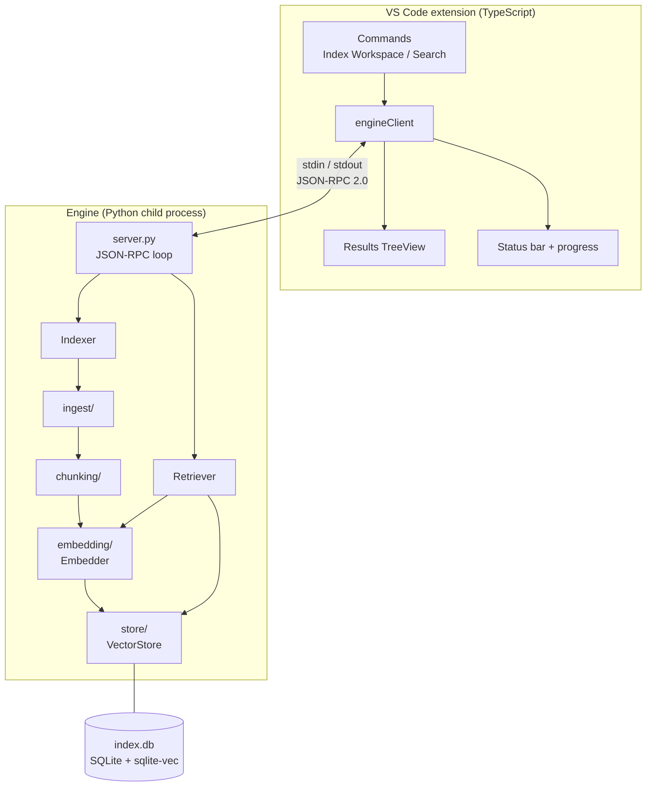

# CodeSense Architecture

> Scope: **Level 1, single-repository semantic search.** Each section is marked ✅ implemented or 📋 planned. Later levels add components. This document grows with them.

## 1. System overview

CodeSense has two processes:

| Process | Language | Responsibility |
|---|---|---|
| **VS Code extension** | TypeScript | Commands, search UI, result navigation, status. Contains **no** indexing, embedding or ranking logic. |
| **Engine** | Python | Everything about search: ingestion, chunking, embeddings, vector storage and retrieval. |

The extension starts the engine as a **child process** and they exchange **JSON-RPC 2.0 messages over stdin/stdout**, the same pattern VS Code uses for language servers. It is not a network service: there are no ports and no HTTP. See [ADR-0001](decisions/0001-python-engine-typescript-extension.md).



## 2. Data flow

### Indexing (ingest ✅, the rest 📋)
```
workspace files
  → ingest/      discover(): prune exclusions + .gitignore, list supported files (names only)
                 read_source(): per file; skip oversized/binary/non-UTF-8 with a recorded reason
  → chunking/    tree-sitter → functions, class headers, methods; uncovered code → line windows
  → indexer      compare content hashes with the store; keep only new or changed chunks
  → embedding/   batch-embed new chunks → 768-dim L2-normalized vectors
  → store/       write chunk metadata + vectors in one transaction per file
```

### Search 📋
```
query text
  → validate (empty / too long)
  → embedding/   embed query with the SAME model as the documents
  → store/       exact k-nearest-neighbour search (cosine distance) → top-K chunk ids
  → store/       resolve metadata (path, lines, symbol, snippet)
  → results      rank + similarity score + source location
```

## 3. Engine modules

| Module | Responsibility | Status |
|---|---|---|
| `models.py` | `CodeChunk`, `SymbolKind` (`SearchResult` arrives in Step 8) | ✅ Step 2.1 |
| `ids.py` | `content_hash()`, `chunk_id()`, `repo_id()` (SHA-256; identity ≠ content) | ✅ Step 2.2 |
| `errors.py`, `log.py` | `CodeSenseError` / `ConfigError`; stderr-only logging via `CODESENSE_LOG_LEVEL` | ✅ Step 2.3 |
| `config.py` | `IndexConfig`: exclusions, size/file/token limits, window chunking; `from_dict` validates untrusted settings | ✅ Step 2.4 |
| `ingest/` | `languages.py` (extension → language), `discovery.py` (walk, exclusions, `.gitignore`, file cap), `filters.py` (size, binary, UTF-8 checks per file); skips recorded as `SkippedFile` with a `SkipReason` | ✅ Step 3 |
| `chunking/` | `symbols.py` (tree-sitter: functions, class header + methods, doc comments), `window.py` (overlapping line windows), `chunker.py` (symbols + gap windows → `CodeChunk`) | ✅ Step 4 |
| `embedding/` | `Embedder` interface, `JinaEmbedder`, `FakeEmbedder` (tests) | 📋 Step 5 |
| `store/` | `VectorStore` interface, SQLite + sqlite-vec implementation | 📋 Step 6 |
| `indexer.py` | Pipeline orchestration, embedding reuse, cancellation | 📋 Step 7 |
| `retrieval.py` | Query → ranked results | 📋 Step 8 |
| `cli.py` | `codesense index` / `codesense search` | 📋 Step 9 |
| `server.py` | JSON-RPC stdio server | 📋 Step 10 |

Only **two** interfaces exist on purpose: `Embedder` and `VectorStore`. The spec requires both to be replaceable, and Level 5 compares models. Everything else is concrete until a second implementation actually exists.

## 4. Storage

- **Location:** VS Code's per-workspace `storageUri`, **never inside the user's repository**.
- **Format:** one SQLite file (`index.db`) holding metadata tables and a `vec0` virtual table for vectors. See [ADR-0003](decisions/0003-sqlite-vec-vector-store.md).
- **Versioning:** the index records its schema version, embedding model id and vector dimensions. An index built with a different model is refused rather than mixed.

## 5. Embedding model

`jinaai/jina-embeddings-v2-base-code`: 768 dimensions, 8192-token context, Apache-2.0, ~161M parameters, runs on CPU. See [ADR-0002](decisions/0002-embedding-model-jina-v2-base-code.md).

**Known constraint:** the model needs `trust_remote_code=True`, and its custom code is incompatible with `transformers>=4.50`. The engine pins `transformers>=4.44,<4.50`.

**Known constraint (parsing):** `tree-sitter` 0.26.0 returns corrupted node positions for files over ~6 KB. The engine pins `tree-sitter>=0.25.2,<0.26`; `test_large_file_has_correct_line_numbers` guards it.

## 6. Cross-cutting rules

- **Local-first:** no source code leaves the machine.
- **Stdout belongs to the protocol:** the engine logs to **stderr only**.
- **Model compatibility:** never mix vectors from different models in one index.
- **Scores are not probabilities:** cosine similarity is shown as "similarity 0.67", never as "67%".
- **Responsiveness:** heavy work runs in the engine process, never on the extension host.

## 7. Architecture Decision Records

| ADR | Decision |
|---|---|
| [0001](decisions/0001-python-engine-typescript-extension.md) | Python engine + thin TypeScript extension over stdio JSON-RPC |
| [0002](decisions/0002-embedding-model-jina-v2-base-code.md) | `jina-embeddings-v2-base-code` as the Level 1 embedding model |
| [0003](decisions/0003-sqlite-vec-vector-store.md) | SQLite + sqlite-vec as the vector store |
| [0004](decisions/0004-repository-layout.md) | Two-package monorepo layout; no `docker/` directory |
